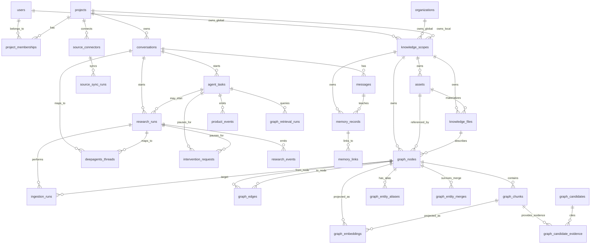

# Data Model And ERD

## Purpose

The data model separates durable product state from agent execution state and file bytes.
It now treats the product as a multimodal knowledge and memory platform. Deep research
and reports are applications built on top of the same source knowledge, graph, memory,
and conversation substrate.

- Postgres is the product system of record.
- Object storage owns uploaded, fetched, and generated file bytes.
- DeepAgents/LangGraph owns checkpoint internals, keyed by product IDs.
- The file-native graph starts in Postgres and can later project to Neo4j.
- Source connectors bring external systems into the same asset/knowledge/graph model.
- Memory records capture durable lessons from user-agent collaboration.
- The graph is evidence-first: extracted claims and relationships remain candidates until
  their source ranges, typed payloads, permissions, and entity identities are validated.
- Search, vector, and optional graph databases are rebuildable projections keyed by stable
  product UUIDs; they are not independent systems of record.

See [knowledge-graph-design.md](knowledge-graph-design.md) for the graph lifecycle,
retrieval routing, promotion rules, and V1 boundary.

## High-Level ERD



## Identity, Project, And Knowledge Scope Tables

### `users`

Represents an account that can own or participate in projects and global knowledge
scopes.

Important fields:

```text
id uuid primary key
email text unique not null
display_name text
created_at timestamptz
updated_at timestamptz
```

Notes:

- V1 can keep auth simple, but every durable object should be traceable to a user.
- External auth provider IDs can be added later.

### `organizations`

Optional team boundary. V1 can defer multi-user org features, but the model should not
block organization-level knowledge later.

Important fields:

```text
id uuid primary key
name text not null
slug text unique
created_by_user_id uuid references users(id)
created_at timestamptz
updated_at timestamptz
archived_at timestamptz null
```

### `projects`

A project is the top-level work container for conversations and project-specific
knowledge. This is what earlier docs called a workspace.

Important fields:

```text
id uuid primary key
organization_id uuid references organizations(id) null
name text not null
slug text
created_by_user_id uuid references users(id)
default_knowledge_scope_id uuid references knowledge_scopes(id) null
status text -- active, archived
metadata jsonb
created_at timestamptz
updated_at timestamptz
archived_at timestamptz null
```

Notes:

- A user can have many projects.
- Each project has a local knowledge scope.
- Retrieval can also include user-global or organization-global knowledge scopes.

### `project_memberships`

Connects users to projects.

Important fields:

```text
project_id uuid references projects(id)
user_id uuid references users(id)
role text -- owner, editor, viewer
created_at timestamptz
primary key (project_id, user_id)
```

### `knowledge_scopes`

A knowledge scope owns reusable assets, knowledge files, and graph records. Scopes let
the system distinguish user-global knowledge from project-local knowledge.

Important fields:

```text
id uuid primary key
scope_type text -- user_global, organization_global, project
owner_user_id uuid references users(id) null
owner_organization_id uuid references organizations(id) null
project_id uuid references projects(id) null
name text not null
description text
visibility text -- private, project, organization
created_at timestamptz
updated_at timestamptz
```

Retrieval order:

```text
1. current conversation/run state
2. current project knowledge scope
3. user global knowledge scope
4. organization global knowledge scope, if enabled
5. external sources/connectors
```

This supports reusable knowledge without mixing project-specific evidence into every
answer.

## Conversation And Session Tables

### `conversations`

A conversation is the user-visible session. It can have many messages and many research
runs.

Important fields:

```text
id uuid primary key
project_id uuid references projects(id)
created_by_user_id uuid references users(id)
title text
status text -- active, archived
summary text
metadata jsonb
created_at timestamptz
updated_at timestamptz
```

Notes:

- `summary` is the compact conversation memory used during context assembly.
- The raw message log remains in `messages`.

### `messages`

Stores user, assistant, and system-visible messages.

Important fields:

```text
id uuid primary key
conversation_id uuid references conversations(id)
role text -- user, assistant, system, tool
content text
content_format text -- markdown, plain_text, json
user_id uuid references users(id) null
research_run_id uuid references research_runs(id) null
metadata jsonb
created_at timestamptz
```

Notes:

- Assistant final answers and user turns should be persisted here.
- Tool internals belong in events/traces, not necessarily as user-visible messages.

### `agent_tasks`

Represents any durable unit of agent work. Deep research is one task type, but V1 should
also support chat answers, ingestion, memory extraction, source deepening, and report
editing without forcing everything into `research_runs`.

Important fields:

```text
id uuid primary key
project_id uuid references projects(id)
conversation_id uuid references conversations(id) null
created_by_user_id uuid references users(id) null
task_type text -- chat_answer, ingest_source, deepen_source, extract_memory, deep_research, report_generation, report_edit
intent text
status text -- created, queued, running, awaiting_intervention, completed, failed, cancelled
settings jsonb
result_summary text null
started_at timestamptz null
completed_at timestamptz null
created_at timestamptz
updated_at timestamptz
```

Notes:

- `agent_tasks` is the platform-level task abstraction.
- `research_runs` can remain as an application-specific child for deep research.
- Queue jobs should generally reference `agent_task_id`, then optionally a
  `research_run_id`.

### `product_events`

Append-only event timeline for any agent task. This generalizes `research_events` so chat,
ingestion, connector syncs, memory writes, and report work can all stream through the same
frontend channel.

Important fields:

```text
id uuid primary key
project_id uuid references projects(id)
conversation_id uuid references conversations(id) null
agent_task_id uuid references agent_tasks(id) null
research_run_id uuid references research_runs(id) null
sequence bigint not null
type text not null
payload jsonb not null
deepagents_event_id text null
trace_id text null
created_at timestamptz
unique(agent_task_id, sequence)
```

Notes:

- V1 can keep `research_events` during transition, but new work should use
  `product_events`.
- Product events are the stable API/frontend contract.

### `deepagents_threads`

Maps product sessions/runs to DeepAgents/LangGraph thread IDs and checkpoint namespaces.

Important fields:

```text
id uuid primary key
project_id uuid references projects(id)
conversation_id uuid references conversations(id) null
research_run_id uuid references research_runs(id) null
thread_id text not null
checkpoint_namespace text
status text -- active, paused, completed, failed
metadata jsonb
created_at timestamptz
updated_at timestamptz
unique(thread_id)
```

Thread strategy:

- Conversation-level thread: preserves long-lived conversational state.
- Research-run-level thread: isolates expensive deep research execution.
- V1 should support both by allowing either `conversation_id` or `research_run_id`.

## Research Run Tables

### `research_runs`

Represents a durable unit of deep research work.

Important fields:

```text
id uuid primary key
project_id uuid references projects(id)
conversation_id uuid references conversations(id)
created_by_user_id uuid references users(id)
intent text not null
status text -- created, planning, awaiting_intervention, researching, writing, editing, completed, failed, cancelled
depth text -- quick, standard, deep
strategy text -- breadth_first, depth_first, hybrid
output_format text -- markdown, report, deck_later
settings jsonb
started_at timestamptz null
completed_at timestamptz null
created_at timestamptz
updated_at timestamptz
```

Notes:

- `research_runs` is the parent for events, interventions, ingestion work, and generated
  report artifacts.

### `research_events`

Append-only product event timeline. This is what the frontend can replay after reconnect.

Important fields:

```text
id uuid primary key
project_id uuid references projects(id)
conversation_id uuid references conversations(id)
research_run_id uuid references research_runs(id)
sequence bigint not null
type text not null
payload jsonb not null
deepagents_event_id text null
trace_id text null
created_at timestamptz
unique(research_run_id, sequence)
```

Notes:

- Product events are stable contracts.
- DeepAgents-native details can be attached in metadata, but the frontend should consume
  product event types.

### `intervention_requests`

Stores human-in-the-loop approval/edit/reject states.

Important fields:

```text
id uuid primary key
project_id uuid references projects(id)
conversation_id uuid references conversations(id)
research_run_id uuid references research_runs(id)
deepagents_thread_id uuid references deepagents_threads(id)
type text -- topic_approval, tool_approval, memory_write, filesystem_write, export_approval
status text -- pending, approved, edited, rejected, expired, resolved
request_payload jsonb
response_payload jsonb null
requested_at timestamptz
responded_at timestamptz null
expires_at timestamptz null
```

## Asset And File Tables

### `source_connectors`

Represents an external source connected to a project or knowledge scope, such as Slack,
GitHub, Notion, Google Drive, a web crawl, or another API.

Important fields:

```text
id uuid primary key
project_id uuid references projects(id) null
knowledge_scope_id uuid references knowledge_scopes(id)
created_by_user_id uuid references users(id)
provider text -- slack, github, notion, google_drive, web, local_folder
name text not null
status text -- active, paused, failed, disconnected
external_account_id text null
config jsonb
sync_cursor jsonb
last_synced_at timestamptz null
created_at timestamptz
updated_at timestamptz
```

Notes:

- Secrets should not live in `config`; use a secret store or provider vault later.
- Connector output should materialize into `assets`, `knowledge_files`, graph records,
  and ingestion runs.

### `source_sync_runs`

Tracks one connector sync attempt.

Important fields:

```text
id uuid primary key
source_connector_id uuid references source_connectors(id)
project_id uuid references projects(id) null
knowledge_scope_id uuid references knowledge_scopes(id)
status text -- queued, running, completed, failed, cancelled
started_at timestamptz null
completed_at timestamptz null
items_seen integer
items_created integer
items_updated integer
items_failed integer
cursor_before jsonb
cursor_after jsonb
error text null
created_at timestamptz
```

Notes:

- Sync runs preserve provenance and make connector behavior auditable.
- Connector items should keep source IDs, authors, timestamps, permissions, and content
  hashes in `assets.source_metadata` or graph metadata.

### `assets`

Metadata for file bytes stored in object storage.

Important fields:

```text
id uuid primary key
knowledge_scope_id uuid references knowledge_scopes(id)
project_id uuid references projects(id) null
conversation_id uuid references conversations(id) null
research_run_id uuid references research_runs(id) null
created_by_user_id uuid references users(id) null
kind text -- upload, fetched_source, generated_report, chart, image, code_snapshot, export
source_connector_id uuid references source_connectors(id) null
source_sync_run_id uuid references source_sync_runs(id) null
filename text
mime_type text
size_bytes bigint
checksum text
storage_uri text not null
source_url text null
source_metadata jsonb
status text -- available, processing, failed, deleted
created_at timestamptz
updated_at timestamptz
```

Notes:

- Object storage is MinIO locally and Supabase Storage in V1 production, behind an
  `ObjectStore` interface that can later target S3.
- Postgres stores pointers and provenance, not large bytes.

### `knowledge_files`

Agent-readable markdown or text files in the virtual workspace.

Important fields:

```text
id uuid primary key
knowledge_scope_id uuid references knowledge_scopes(id)
project_id uuid references projects(id) null
conversation_id uuid references conversations(id) null
research_run_id uuid references research_runs(id) null
asset_id uuid references assets(id) null
path text not null
file_type text -- research_map, topic_card, source_card, repo_card, report_section, scratch
title text
frontmatter jsonb
content_hash text
status text -- active, stale, archived
created_by text -- user, agent, system
created_at timestamptz
updated_at timestamptz
unique(knowledge_scope_id, path)
```

Notes:

- These are the files the agent can read and update.
- They are also graph entry points through `graph_nodes.file_path`.
- `knowledge_scope_id` controls whether a file is global, organization-level, or
  project-local.

## How The Graph References Files

The graph should distinguish original file bytes from agent-readable knowledge files.

Use `asset_id` when a graph record points to original or generated file bytes in object
storage:

```text
uploaded PDF
uploaded image
fetched web snapshot
code archive
generated chart
exported slide deck
```

Use `knowledge_file_id` when a graph record points to a markdown/text file in the virtual
workspace:

```text
source_017.md
topic_supply_chain.md
repo_card.md
research_map.md
report_section_01.md
image_004.md
```

A graph node can point to both when both representations exist:

```text
GraphNode(type = source)
  asset_id = original PDF in object storage
  knowledge_file_id = source card markdown file
```

Use `graph_chunks` when the graph needs to reference a specific page range, section, byte
range, or code line range inside an asset or knowledge file.

Example:

```text
Source017
  -> asset_id: asset_pdf_123
  -> knowledge_file_id: kf_source_017_md
  -> HAS_CHUNK: graph_chunk pages 59-80
```

This lets graph-guided retrieval return:

- the source/card file the agent should read first
- the raw asset to inspect if deeper evidence is needed
- the exact page/section/line range already known by the graph

## Graph Tables

The graph tables are the canonical, evidence-linked product model. Full-text indexes,
vector indexes, and future Neo4j records are projections of these IDs. Model extraction
writes to `graph_candidates`; only validated candidates are promoted into canonical nodes
and edges.

### `graph_schema_versions`

Versioned registry for allowed node types, edge relations, payload schemas, and promotion
rules. Application code loads and validates this registry; extraction output cannot invent
new canonical types at runtime.

```text
id uuid primary key
object_kind text -- node, edge, candidate
type_name text
version integer
json_schema jsonb
allowed_from_types text[] null
allowed_to_types text[] null
promotion_policy jsonb
status text -- draft, active, retired
created_at timestamptz
unique(object_kind, type_name, version)
```

### `graph_nodes`

Generic node table for the file-native knowledge graph.

Important fields:

```text
id uuid primary key
knowledge_scope_id uuid references knowledge_scopes(id)
project_id uuid references projects(id) null
type text -- topic, source, document, repository, commit, code_file, symbol, chunk, entity, claim, fact, report_section, artifact
schema_version integer not null
external_id text null
canonical_key text null
title text
summary text
knowledge_file_id uuid references knowledge_files(id) null
asset_id uuid references assets(id) null
metadata jsonb
ingestion_level text null
status text -- active, corrected, superseded, retracted, archived
valid_from timestamptz null
valid_until timestamptz null
source_revision text null
superseded_by_node_id uuid references graph_nodes(id) null
created_at timestamptz
updated_at timestamptz
```

Notes:

- `external_id` can store source IDs, repository IDs, commit SHAs, provider IDs, etc.
- `canonical_key` is a deterministic domain identity when one exists; similarity alone
  must not assign it.
- `schema_version` resolves the node payload against the versioned graph type registry.
- Nodes are mechanical records; relevance is judged by the agent.
- Claim nodes are source-relative assertions. A claim is not treated as global truth.

### `graph_edges`

Directed relationship table.

Important fields:

```text
id uuid primary key
knowledge_scope_id uuid references knowledge_scopes(id)
project_id uuid references projects(id) null
from_node_id uuid references graph_nodes(id)
relation text -- COVERS, DESCRIBED_BY, HAS_CHUNK, SUPPORTS, CONTRADICTS, CITES, DEFINES, DEPENDS_ON, DERIVED_FROM
to_node_id uuid references graph_nodes(id)
schema_version integer not null
confidence numeric null
status text -- active, corrected, superseded, retracted, archived
extraction_method text -- deterministic, parser, model, user
extraction_policy_version text null
source_revision text null
valid_from timestamptz null
valid_until timestamptz null
metadata jsonb
created_at timestamptz
updated_at timestamptz
```

Notes:

- This table lets Postgres act as the V1 graph repository.
- Neo4j can later mirror these records as a projection.
- Semantic edges such as `ASSERTS`, `SUPPORTED_BY`, and `CONTRADICTED_BY` must have
  evidence links through their promoted candidate or explicit evidence records.
- Similarity and retrieval scores are not stored as evidence confidence.

### `graph_chunks`

Chunk/page/range metadata for source and code references.

Important fields:

```text
id uuid primary key
knowledge_scope_id uuid references knowledge_scopes(id)
project_id uuid references projects(id) null
node_id uuid references graph_nodes(id)
knowledge_file_id uuid references knowledge_files(id) null
asset_id uuid references assets(id) null
chunk_index integer
source_revision text null
page_start integer null
page_end integer null
section_path text[] null
char_start bigint null
char_end bigint null
line_start integer null
line_end integer null
bounding_boxes jsonb null
table_id text null
row_start integer null
row_end integer null
column_start integer null
column_end integer null
sheet_name text null
cell_range text null
repository text null
commit_sha text null
file_path text null
symbol text null
external_permalink text null
external_item_id text null
text_content text
content_hash text
parser_name text null
parser_version text null
metadata jsonb
created_at timestamptz
updated_at timestamptz
```

Notes:

- Structured ranges make citation resolution and verification deterministic.
- V1 stores extracted chunk text in Postgres for full-text retrieval and reproducible
  citations. Original bytes remain in object storage.
- A citation is stale when its source revision or content hash no longer resolves.

### `graph_candidates`

Staging records produced by parsers, models, deterministic extractors, or users. These
records prevent uncertain extraction output from entering the canonical graph directly.

Important fields:

```text
id uuid primary key
knowledge_scope_id uuid references knowledge_scopes(id)
project_id uuid references projects(id) null
ingestion_run_id uuid references ingestion_runs(id)
candidate_kind text -- node, edge, claim, alias, merge
candidate_type text
payload jsonb
schema_version integer
status text -- extracted, validating, accepted, rejected, needs_review, superseded
extraction_method text -- deterministic, parser, model, user
extractor_name text
extractor_version text
policy_version text
prompt_hash text null
input_content_hash text
confidence numeric null
validation_results jsonb
promoted_node_id uuid references graph_nodes(id) null
promoted_edge_id uuid references graph_edges(id) null
reviewed_by_user_id uuid references users(id) null
reviewed_at timestamptz null
created_at timestamptz
updated_at timestamptz
```

Notes:

- Confidence cannot substitute for evidence.
- Automatic promotion requires typed validation, resolvable evidence, permission checks,
  and completed entity resolution.
- Candidate decisions remain auditable after promotion or rejection.

### `graph_candidate_evidence`

Links an extraction candidate to the exact chunks used to create or validate it.

```text
candidate_id uuid references graph_candidates(id)
graph_chunk_id uuid references graph_chunks(id)
relation text -- extracted_from, supports, contradicts, validates
quoted_text text null
content_hash text
created_at timestamptz
primary key (candidate_id, graph_chunk_id, relation)
```

### `graph_entity_aliases`

Maps observed names to canonical entity nodes without losing the original mention.

```text
id uuid primary key
knowledge_scope_id uuid references knowledge_scopes(id)
entity_node_id uuid references graph_nodes(id)
alias text
normalized_alias text
source_chunk_id uuid references graph_chunks(id) null
external_namespace text null
external_id text null
status text -- active, candidate, rejected
created_at timestamptz
unique(knowledge_scope_id, external_namespace, external_id)
```

### `graph_entity_merges`

Append-only log of reversible entity merge decisions.

```text
id uuid primary key
knowledge_scope_id uuid references knowledge_scopes(id)
survivor_node_id uuid references graph_nodes(id)
merged_node_id uuid references graph_nodes(id)
reason text
evidence jsonb
decision_method text -- deterministic, user, reviewed_model
decided_by_user_id uuid references users(id) null
reversed_at timestamptz null
reversal_reason text null
created_at timestamptz
```

Similarity can propose a merge but cannot create an accepted merge by itself.

### `graph_embeddings`

Registry for rebuildable vector projections. Vector bytes may live in pgvector or another
adapter while Postgres retains projection metadata.

```text
id uuid primary key
knowledge_scope_id uuid references knowledge_scopes(id)
target_type text -- graph_chunk, graph_node, graph_edge
target_id uuid
target_field text
content_hash text
embedding_model text
dimensions integer
projection_status text -- pending, current, stale, failed
vector_ref text null
created_at timestamptz
updated_at timestamptz
unique(target_type, target_id, target_field, embedding_model, content_hash)
```

V1 embeds chunks first. Entity, claim, and triplet embeddings require evaluation evidence
for a defined query class before becoming default behavior.

### `graph_retrieval_runs`

Auditable retrieval result sets shared by lexical, vector, graph, and hybrid strategies.

```text
id uuid primary key
agent_task_id uuid references agent_tasks(id) null
conversation_id uuid references conversations(id) null
query_text text
knowledge_scope_ids uuid[]
strategy text -- lexical, vector_chunk, entity, graph, hybrid, report_verification
strategy_version text
filters jsonb
ranked_results jsonb
graph_paths jsonb
supporting_chunk_ids uuid[]
permission_decisions jsonb
projection_versions jsonb
latency_ms integer
token_cost jsonb
trace_id text null
created_at timestamptz
```

Notes:

- Every strategy returns the same result-set contract.
- Retrieval score is distinct from evidence support or claim confidence.
- Graph traversal should be selected only for relationship, multi-hop, or verification
  queries where evaluation shows a material benefit.

### `ingestion_runs`

Tracks progressive ingestion and targeted deepening.

Important fields:

```text
id uuid primary key
knowledge_scope_id uuid references knowledge_scopes(id)
project_id uuid references projects(id) null
agent_task_id uuid references agent_tasks(id) null
asset_id uuid references assets(id) null
target_node_id uuid references graph_nodes(id) null
mode text -- shallow_card, section_indexed, topic_deepened, claims_and_citations, code_symbol_trace
status text -- queued, running, completed, failed, cancelled
coverage jsonb -- pages, sections, files, symbols, topics
budget jsonb
extractor_versions jsonb
source_revision text null
result_summary text
error text null
started_at timestamptz null
completed_at timestamptz null
created_at timestamptz
```

An initial upload targets `asset_id` because its graph node does not exist yet. Targeted
deepening can point to `target_node_id`; a run must have at least one of these targets.

## Reports And Citations

Report sections can be represented as `knowledge_files` and `graph_nodes` initially.
Dedicated report tables can be added when editing/export workflows need stronger
constraints.

V1 recommendation:

```text
knowledge_files(file_type = report_section)
graph_nodes(type = report_section)
graph_edges(report_section)-[:CITES]->(source/chunk/code_reference)
graph_edges(report_section)-[:USES_ASSET]->(asset/artifact)
```

This keeps report state aligned with the same file-native graph model.

Visual report blocks should reference `asset_id` for rendered/generated/uploaded visuals
and use graph edges for provenance:

```text
ImageBlock/ChartBlock/TableBlock
  -> asset_id
  -> citation_ids
  -> graph_edges(report_section)-[:USES_ASSET]->(asset)
```

The canonical report can remain Markdown in V1, with structured block metadata stored in
frontmatter or `knowledge_files.frontmatter`. Dedicated report block tables can be added
later if collaboration or rich visual editing requires stricter structure.

## Memory Tables

### `memory_records`

Stores durable lessons from user-agent collaboration. This is not the raw chat log; it is
the distilled memory the agent should consider in future turns.

Important fields:

```text
id uuid primary key
knowledge_scope_id uuid references knowledge_scopes(id)
project_id uuid references projects(id) null
conversation_id uuid references conversations(id) null
message_id uuid references messages(id) null
created_by_user_id uuid references users(id) null
created_by text -- user, agent, system
memory_type text -- preference, correction, decision, terminology, source_note, reusable_fact, procedure
status text -- candidate, approved, active, rejected, superseded, archived
title text
content text not null
confidence numeric null
sensitivity text -- normal, private, sensitive
requires_approval boolean
approved_by_user_id uuid references users(id) null
approved_at timestamptz null
superseded_by_memory_id uuid references memory_records(id) null
metadata jsonb
created_at timestamptz
updated_at timestamptz
```

Notes:

- Memory candidates can be proposed automatically, but important or sensitive memories
  should require user approval.
- Memory scope controls whether a lesson is user-global, project-local, or organization
  level later.
- Corrections and source quality judgments should be linked to the source records they
  modify.

### `memory_links`

Connects a memory to the evidence, conversation, asset, graph record, or output it came
from or applies to.

Important fields:

```text
id uuid primary key
memory_record_id uuid references memory_records(id)
target_type text -- message, asset, knowledge_file, graph_node, graph_edge, graph_chunk, report_section, source_connector
target_id uuid not null
relation text -- derived_from, applies_to, corrects, supersedes, prefers, cites
metadata jsonb
created_at timestamptz
```

Notes:

- Links let the agent recall both the memory and why it exists.
- This is how a user correction can override an extracted claim or mark a source as
  outdated.

## Context Pack Inputs

A context pack is assembled from these records:

```text
conversation summary         conversations.summary
recent messages              messages
active task/run state         agent_tasks, research_runs
pending interventions        intervention_requests
thread/checkpoint mapping    deepagents_threads
graph result sets            graph_retrieval_runs plus referenced nodes/edges/chunks
selected knowledge files     knowledge_files
asset metadata               assets
relevant memories            memory_records, memory_links
event history                product_events, research_events
```

The context pack should record which database IDs were included so a run is auditable and
reproducible.

## Indexing Strategy

Initial indexes:

```text
project_id on project-scoped runtime tables
knowledge_scope_id on assets, knowledge_files, graph_nodes, graph_edges, graph_chunks
status, candidate_kind, candidate_type on graph_candidates
candidate_id, graph_chunk_id on graph_candidate_evidence
normalized_alias, entity_node_id on graph_entity_aliases
survivor_node_id, merged_node_id on graph_entity_merges
target_type, target_id, projection_status on graph_embeddings
agent_task_id, strategy, created_at on graph_retrieval_runs
conversation_id on messages, research_runs, research_events
agent_task_id on product_events
research_run_id on events, interventions, ingestion_runs
unique(research_run_id, sequence) for event replay
unique(agent_task_id, sequence) for generalized event replay
unique(knowledge_scope_id, path) for knowledge_files
from_node_id, to_node_id, relation on graph_edges
type, external_id on graph_nodes
unique(knowledge_scope_id, canonical_key) where canonical_key is not null
GIN full-text index on graph_chunks.text_content
source revision and structured range fields on graph_chunks
asset checksum for dedupe
provider, status on source_connectors
source_connector_id on source_sync_runs and connector-created assets
memory_type, status, knowledge_scope_id on memory_records
memory_record_id, target_type, target_id on memory_links
```

Later indexes and projections:

- optional full-text over generated `knowledge_files`
- vector search over chunks, followed by evaluated claim/entity/triplet projections
- Neo4j projection for complex multi-hop graph queries
- code symbol/path indexes for repository research
- connector-specific indexes for Slack channel/thread IDs, GitHub repo/file IDs, and
  external timestamps
- memory retrieval indexes over memory type, target links, recency, and approval status

## Open Decisions

- Should V1 use one DeepAgents thread per conversation plus child threads for research
  runs, or only run-level threads?
- Should the UI call the top-level container "project" everywhere, or keep "workspace" as
  the product label while using `projects` internally?
- Should user-global knowledge be enabled in V1 or reserved until project-local retrieval
  is stable?
- Should report sections get dedicated tables immediately or stay as graph-backed
  knowledge files?
- Which candidate types and confidence policies are safe for automatic promotion?
- Which query classes justify graph traversal after latency, cost, and retrieval evaluation?
- Which entity namespaces have strong deterministic identity keys in V1?
- Which ORM/migration stack should we use: SQLAlchemy + Alembic, SQLModel + Alembic, or
  plain SQL migrations?
- Which connector should be first after local uploads: Slack, GitHub, Notion, or Google
  Drive?
- Should memory writes require explicit approval by default, or only for sensitive and
  high-impact memory types?
- Should `research_events` be replaced fully by `product_events` in V1, or kept as a
  compatibility view for research-specific screens?
