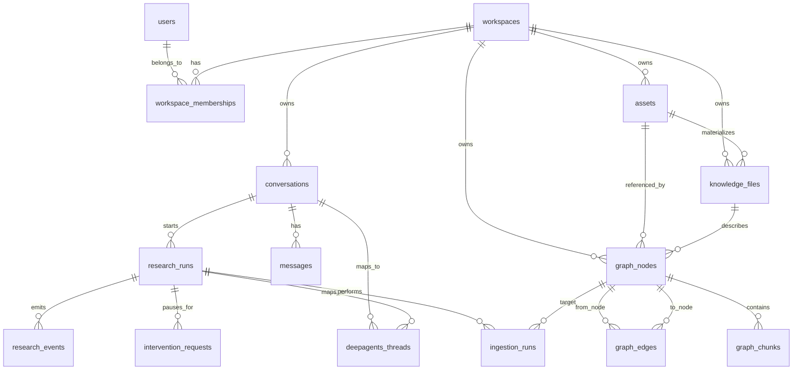

# Data Model And ERD

## Purpose

The data model separates durable product state from agent execution state and file bytes.

- Postgres is the product system of record.
- Object storage owns uploaded, fetched, and generated file bytes.
- DeepAgents/LangGraph owns checkpoint internals, keyed by product IDs.
- The file-native graph starts in Postgres and can later project to Neo4j.

## High-Level ERD



## Identity And Workspace Tables

### `users`

Represents an account that can own or participate in workspaces.

Important fields:

```text
id uuid primary key
email text unique not null
display_name text
created_at timestamptz
updated_at timestamptz
```

Notes:

- V1 can keep auth simple, but every durable object should be traceable to a user.
- External auth provider IDs can be added later.

### `workspaces`

A workspace is the top-level boundary for assets, conversations, graph data, and knowledge
files.

Important fields:

```text
id uuid primary key
name text not null
slug text unique
created_by_user_id uuid references users(id)
created_at timestamptz
updated_at timestamptz
archived_at timestamptz null
```

### `workspace_memberships`

Connects users to workspaces.

Important fields:

```text
workspace_id uuid references workspaces(id)
user_id uuid references users(id)
role text -- owner, editor, viewer
created_at timestamptz
primary key (workspace_id, user_id)
```

## Conversation And Session Tables

### `conversations`

A conversation is the user-visible session. It can have many messages and many research
runs.

Important fields:

```text
id uuid primary key
workspace_id uuid references workspaces(id)
created_by_user_id uuid references users(id)
title text
status text -- active, archived
summary text
metadata jsonb
created_at timestamptz
updated_at timestamptz
```

Notes:

- `summary` is the compact conversation memory used during context assembly.
- The raw message log remains in `messages`.

### `messages`

Stores user, assistant, and system-visible messages.

Important fields:

```text
id uuid primary key
conversation_id uuid references conversations(id)
role text -- user, assistant, system, tool
content text
content_format text -- markdown, plain_text, json
user_id uuid references users(id) null
research_run_id uuid references research_runs(id) null
metadata jsonb
created_at timestamptz
```

Notes:

- Assistant final answers and user turns should be persisted here.
- Tool internals belong in events/traces, not necessarily as user-visible messages.

### `deepagents_threads`

Maps product sessions/runs to DeepAgents/LangGraph thread IDs and checkpoint namespaces.

Important fields:

```text
id uuid primary key
workspace_id uuid references workspaces(id)
conversation_id uuid references conversations(id) null
research_run_id uuid references research_runs(id) null
thread_id text not null
checkpoint_namespace text
status text -- active, paused, completed, failed
metadata jsonb
created_at timestamptz
updated_at timestamptz
unique(thread_id)
```

Thread strategy:

- Conversation-level thread: preserves long-lived conversational state.
- Research-run-level thread: isolates expensive deep research execution.
- V1 should support both by allowing either `conversation_id` or `research_run_id`.

## Research Run Tables

### `research_runs`

Represents a durable unit of deep research work.

Important fields:

```text
id uuid primary key
workspace_id uuid references workspaces(id)
conversation_id uuid references conversations(id)
created_by_user_id uuid references users(id)
intent text not null
status text -- created, planning, awaiting_intervention, researching, writing, editing, completed, failed, cancelled
depth text -- quick, standard, deep
strategy text -- breadth_first, depth_first, hybrid
output_format text -- markdown, report, deck_later
settings jsonb
started_at timestamptz null
completed_at timestamptz null
created_at timestamptz
updated_at timestamptz
```

Notes:

- `research_runs` is the parent for events, interventions, ingestion work, and generated
  report artifacts.

### `research_events`

Append-only product event timeline. This is what the frontend can replay after reconnect.

Important fields:

```text
id uuid primary key
workspace_id uuid references workspaces(id)
conversation_id uuid references conversations(id)
research_run_id uuid references research_runs(id)
sequence bigint not null
type text not null
payload jsonb not null
deepagents_event_id text null
trace_id text null
created_at timestamptz
unique(research_run_id, sequence)
```

Notes:

- Product events are stable contracts.
- DeepAgents-native details can be attached in metadata, but the frontend should consume
  product event types.

### `intervention_requests`

Stores human-in-the-loop approval/edit/reject states.

Important fields:

```text
id uuid primary key
workspace_id uuid references workspaces(id)
conversation_id uuid references conversations(id)
research_run_id uuid references research_runs(id)
deepagents_thread_id uuid references deepagents_threads(id)
type text -- topic_approval, tool_approval, memory_write, filesystem_write, export_approval
status text -- pending, approved, edited, rejected, expired, resolved
request_payload jsonb
response_payload jsonb null
requested_at timestamptz
responded_at timestamptz null
expires_at timestamptz null
```

## Asset And File Tables

### `assets`

Metadata for file bytes stored in object storage.

Important fields:

```text
id uuid primary key
workspace_id uuid references workspaces(id)
conversation_id uuid references conversations(id) null
research_run_id uuid references research_runs(id) null
created_by_user_id uuid references users(id) null
kind text -- upload, fetched_source, generated_report, chart, image, code_snapshot, export
filename text
mime_type text
size_bytes bigint
checksum text
storage_uri text not null
source_url text null
source_metadata jsonb
status text -- available, processing, failed, deleted
created_at timestamptz
updated_at timestamptz
```

Notes:

- Object storage is MinIO locally and S3 in production.
- Postgres stores pointers and provenance, not large bytes.

### `knowledge_files`

Agent-readable markdown or text files in the virtual workspace.

Important fields:

```text
id uuid primary key
workspace_id uuid references workspaces(id)
conversation_id uuid references conversations(id) null
research_run_id uuid references research_runs(id) null
asset_id uuid references assets(id) null
path text not null
file_type text -- research_map, topic_card, source_card, repo_card, report_section, scratch
title text
frontmatter jsonb
content_hash text
status text -- active, stale, archived
created_by text -- user, agent, system
created_at timestamptz
updated_at timestamptz
unique(workspace_id, path)
```

Notes:

- These are the files the agent can read and update.
- They are also graph entry points through `graph_nodes.file_path`.

## Graph Tables

### `graph_nodes`

Generic node table for the file-native knowledge graph.

Important fields:

```text
id uuid primary key
workspace_id uuid references workspaces(id)
type text -- topic, source, document, repository, commit, code_file, symbol, chunk, entity, claim, fact, report_section, artifact
external_id text null
title text
summary text
knowledge_file_id uuid references knowledge_files(id) null
asset_id uuid references assets(id) null
metadata jsonb
ingestion_level text null
created_at timestamptz
updated_at timestamptz
```

Notes:

- `external_id` can store source IDs, repository IDs, commit SHAs, provider IDs, etc.
- Nodes are mechanical records; relevance is judged by the agent.

### `graph_edges`

Directed relationship table.

Important fields:

```text
id uuid primary key
workspace_id uuid references workspaces(id)
from_node_id uuid references graph_nodes(id)
relation text -- COVERS, DESCRIBED_BY, HAS_CHUNK, SUPPORTS, CONTRADICTS, CITES, DEFINES, DEPENDS_ON, DERIVED_FROM
to_node_id uuid references graph_nodes(id)
confidence numeric null
metadata jsonb
created_at timestamptz
updated_at timestamptz
```

Notes:

- This table lets Postgres act as the V1 graph repository.
- Neo4j can later mirror these records as a projection.

### `graph_chunks`

Chunk/page/range metadata for source and code references.

Important fields:

```text
id uuid primary key
workspace_id uuid references workspaces(id)
node_id uuid references graph_nodes(id)
knowledge_file_id uuid references knowledge_files(id) null
asset_id uuid references assets(id) null
chunk_index integer
source_range text -- page range, byte range, line range, section heading
text_preview text
content_hash text
metadata jsonb
created_at timestamptz
updated_at timestamptz
```

Notes:

- Store enough preview to route the agent.
- Full text can live in knowledge files/object storage; database can add full-text search
  later.

### `ingestion_runs`

Tracks progressive ingestion and targeted deepening.

Important fields:

```text
id uuid primary key
workspace_id uuid references workspaces(id)
research_run_id uuid references research_runs(id) null
target_node_id uuid references graph_nodes(id)
mode text -- shallow_card, section_indexed, topic_deepened, claims_and_citations, code_symbol_trace
status text -- queued, running, completed, failed, cancelled
coverage jsonb -- pages, sections, files, symbols, topics
budget jsonb
result_summary text
error text null
started_at timestamptz null
completed_at timestamptz null
created_at timestamptz
```

## Reports And Citations

Report sections can be represented as `knowledge_files` and `graph_nodes` initially.
Dedicated report tables can be added when editing/export workflows need stronger
constraints.

V1 recommendation:

```text
knowledge_files(file_type = report_section)
graph_nodes(type = report_section)
graph_edges(report_section)-[:CITES]->(source/chunk/code_reference)
```

This keeps report state aligned with the same file-native graph model.

## Context Pack Inputs

A context pack is assembled from these records:

```text
conversation summary         conversations.summary
recent messages              messages
active run state             research_runs
pending interventions        intervention_requests
thread/checkpoint mapping    deepagents_threads
graph result sets            graph_nodes, graph_edges, graph_chunks
selected knowledge files     knowledge_files
asset metadata               assets
event history                research_events
```

The context pack should record which database IDs were included so a run is auditable and
reproducible.

## Indexing Strategy

Initial indexes:

```text
workspace_id on all workspace-scoped tables
conversation_id on messages, research_runs, research_events
research_run_id on events, interventions, ingestion_runs
unique(research_run_id, sequence) for event replay
unique(workspace_id, path) for knowledge_files
from_node_id, to_node_id, relation on graph_edges
type, external_id on graph_nodes
asset checksum for dedupe
```

Later indexes:

- Postgres full-text over `knowledge_files` and `graph_chunks`
- optional vector search over summaries/chunks
- Neo4j projection for complex multi-hop graph queries
- code symbol/path indexes for repository research

## Open Decisions

- Should V1 use one DeepAgents thread per conversation plus child threads for research
  runs, or only run-level threads?
- Should report sections get dedicated tables immediately or stay as graph-backed
  knowledge files?
- Should graph chunks store full text in Postgres or only previews plus file/object
  references?
- Which ORM/migration stack should we use: SQLAlchemy + Alembic, SQLModel + Alembic, or
  plain SQL migrations?
